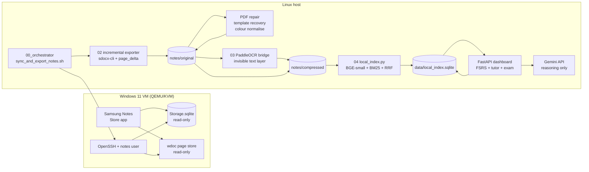

# Architecture

The system is a one-way pipeline: Samsung Notes remains the source of truth, the
Windows VM is a read-only extraction surface, and every derived artifact is
rebuildable from the exports.



## Data flow

1. **Sync** — `00_orchestrator/sync_and_export_notes.sh` acquires
   `ai_agend_history/orchestrator.lock`, checks the 55 GB / 15 GiB guardrails,
   starts the VM only if it was not already running, uploads
   `sync_now.sh`+`click_sync.ps1` to the guest, clicks **Sync now** through the
   interactive session, and waits for `IsDirty=0` plus read-only WDoc
   quiescence.
2. **Delta export** — `02_extracted_notes_pdf/script/incremental_export.py`
   inventories `Storage.sqlite` with `mode=ro`, compares modification times and
   content hashes in `incremental_state.sqlite`, and renders only changed pages.
   Page artifacts are cached by a content hash that includes page bytes,
   referenced media, renderer version/config and layout dependencies.
3. **Repair and normalise** — `pdf_template_recovery.py` fixes legacy exports
   whose page count is correct but whose embedded PDF paper is missing. It reads
   visible order only from `pageIdInfo.dat`, binds `custom PDF page N` to
   `media/<name>.pdf` page `N-1`, proves the CLI drew only a background fill, and
   fails closed on ink overlays. `pdf_color_normalize.py` repairs black-canvas
   pages. Originals are preserved before any atomic publication.
4. **OCR** — `03_rtx_compression_ocr/paddle_ocr_pdf_batch.py` skips pages with
   ≥50 clean selectable characters, renders sparse pages, tries 0°/90°/270°,
   maps boxes back to the upright page, inserts invisible text, verifies page
   count and pixel equality, then losslessly compresses with pikepdf.
5. **Index** — `04_learning_recall_app/my_notes_graph/src/local_index.py`
   discovers every PDF, classifies it as `searchable`, `empty` or `unreadable`,
   chunks page-aware text, and stores BM25 terms plus local BGE-small vectors in
   `data/local_index.sqlite`. Retrieval fuses lexical and dense ranks with
   reciprocal-rank fusion (`k=60`); no note text is sent to an embedding API.
6. **Study** — `00_main.py` and `engine/routes.py` serve the dashboard. Gemini
   is used only for reasoning (tutor, exam grading, question factory), with a
   server-side answer key, `countTokens` below the budget, bounded jittered
   retries, and immediate stop on 401/403.

## Storage layout

```
02_extracted_notes_pdf/
  notes/original/       exact migrated exports, never written by OCR
  notes/compressed/     relative placeholders, hard links, or verified derivatives
  notes/export_manifest.json
  ai_agend_history/     state DBs, reports, preserved originals, page cache
04_learning_recall_app/my_notes_graph/
  data/local_index.sqlite   BM25 + dense index
  data/recall.sqlite        FSRS cards, logs, quiz bank, games
  data/memory.db            legacy study history (preserved)
  data/index.json           legacy JSON index (preserved)
```

`notes/compressed/` entries can be:

- a **relative symlink** to the original when no derivative is needed;
- a **hard link** when the original is already searchable;
- a **real PDF** when OCR or lossless compression produced a verified
  derivative.

Publication always replaces the link atomically and never follows it for an
in-place write.

## Process and lock model

| Lock | Scope |
|---|---|
| `ai_agend_history/orchestrator.lock` | one full sync/export/index run |
| `ai_agend_history/gpu_ocr.lock` | serialized PaddleOCR GPU work |
| `data/local_index.lock` | index rebuild |
| `01_vm_windows_sync/vm/qemu.pid` + command-line check | VM ownership |

A pre-existing VM is never stopped by the runner; only a VM the runner started
is shut down via ACPI. The runner never force-kills QEMU.

## Security boundaries

- Samsung Notes production databases are read-only (`mode=ro`,
  `PRAGMA query_only=ON`).
- No note content is uploaded for embeddings or OCR.
- Gemini receives selected snippets and question context only when the user
  explicitly invokes a reasoning feature.
- Secrets live outside the repository and are never logged.
- The dashboard binds `127.0.0.1` by default; `RECALL_HOST=0.0.0.0` is an
  explicit opt-in for LAN/phone access.

## Failure philosophy

Every stage prefers **preserving the previous artifact** over publishing a
partial result:

- an unsupported page fails the note, not the whole run;
- a failed OCR derivative leaves the placeholder intact;
- a failed verification keeps the original and reports nonzero;
- a disk-guard refusal is a failure, not a silent skip;
- empty and unreadable sources are reported explicitly instead of being called
  searchable.